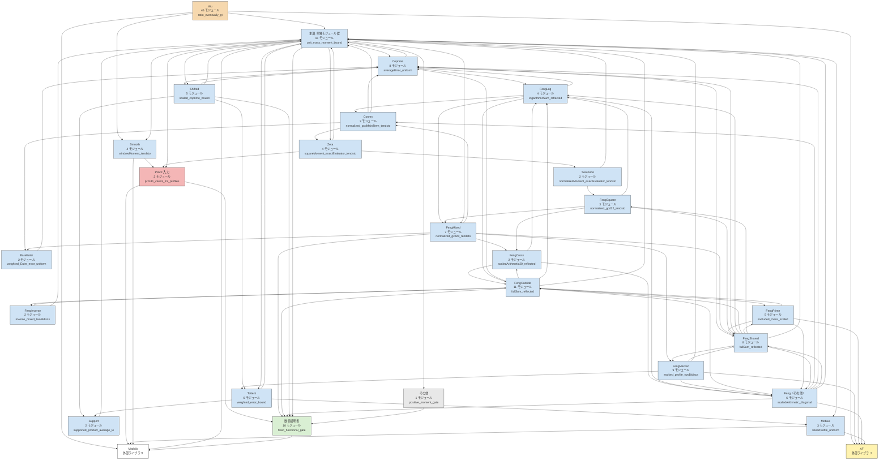

# 依存グラフ（要約版）

主定理モジュール [`WuProportion`](../lean/WuProportion.lean) から `import` を逆向きにたどって到達できるローカルモジュール **171 件**（全 698 件中）を、層と名前の接頭辞で束ねた図です。矢印は import 方向（A → B は A が B を import）。各ノードはモジュール数と代表定理（そのノードで主定理に最も近いモジュールの、最後の `#print axioms` 対象）を示します。

生成: `python3 tools/gen_dependency_graph.py`（`import` 行と [checks/clean-project-verification-2026-11-07.json](../checks/clean-project-verification-2026-11-07.json) の記録から自動生成。手書きの依存関係・定理名はありません）。

- 全体版（機械可読）: [dependency-graph.json](dependency-graph.json), [dependency-graph.dot](dependency-graph.dot)
- 要約版（画像）: [dependency-graph.svg](dependency-graph.svg)
- モジュール表: [modules.md](modules.md)

要約図の群間に見える循環は、複数モジュールを同じ群へ集約したことによるものです。Lean モジュールの import 循環を意味しません。個別の辺は JSON / DOT を参照してください。

## 要約ノード一覧

| ノード | 層 | モジュール数 | 代表定理 | 代表定理の公理 | 含まれるモジュール |
| --- | --- | --- | --- | --- | --- |
| Wu | 計数（Wu） | 46 | `XiPrime8845.WuProportion.ratio_eventually_gt` | [propext, Classical.choice, Quot.sound, PRZZ.przz41_case3_K2_profiles] | [WuAuxiliary](../lean/WuAuxiliary.lean), [WuAuxiliaryBoundary](../lean/WuAuxiliaryBoundary.lean), [WuAuxiliaryHorizontal](../lean/WuAuxiliaryHorizontal.lean), [WuAuxiliaryMultiplicity](../lean/WuAuxiliaryMultiplicity.lean), [WuBoundaryPhase](../lean/WuBoundaryPhase.lean), [WuBoundaryZeros](../lean/WuBoundaryZeros.lean), [WuContourCounting](../lean/WuContourCounting.lean), [WuCriticalDeflation](../lean/WuCriticalDeflation.lean), [WuCriticalMultiplicity](../lean/WuCriticalMultiplicity.lean), [WuDeflatedContour](../lean/WuDeflatedContour.lean), [WuDeflatedDetection](../lean/WuDeflatedDetection.lean), [WuDiskCenter](../lean/WuDiskCenter.lean), [WuDiskGrowth](../lean/WuDiskGrowth.lean), [WuDyadicCounting](../lean/WuDyadicCounting.lean), [WuEdgeLog](../lean/WuEdgeLog.lean), [WuEtaMainPhase](../lean/WuEtaMainPhase.lean), [WuFiniteDeflation](../lean/WuFiniteDeflation.lean), [WuGammaCancellation](../lean/WuGammaCancellation.lean), [WuGammaJets](../lean/WuGammaJets.lean), [WuGammaPhase](../lean/WuGammaPhase.lean), [WuHorizontalBound](../lean/WuHorizontalBound.lean), [WuHorizontalIntegral](../lean/WuHorizontalIntegral.lean), [WuIndependentWindows](../lean/WuIndependentWindows.lean), [WuLeftReturn](../lean/WuLeftReturn.lean), [WuLittlewood](../lean/WuLittlewood.lean), [WuLocalCounting](../lean/WuLocalCounting.lean), [WuMomentTransfer](../lean/WuMomentTransfer.lean), [WuParallelReturn](../lean/WuParallelReturn.lean), [WuPhaseCrossings](../lean/WuPhaseCrossings.lean), [WuProportion](../lean/WuProportion.lean), [WuQuotientReturn](../lean/WuQuotientReturn.lean), [WuRightBoundary](../lean/WuRightBoundary.lean), [WuRightLittlewood](../lean/WuRightLittlewood.lean), [WuRightMollifier](../lean/WuRightMollifier.lean), [WuSafeEndpoints](../lean/WuSafeEndpoints.lean), [WuStirling](../lean/WuStirling.lean), [WuStirlingMoment](../lean/WuStirlingMoment.lean), [WuStirlingTransfer](../lean/WuStirlingTransfer.lean), [WuSubintervalLog](../lean/WuSubintervalLog.lean), [WuTotalAsymptotic](../lean/WuTotalAsymptotic.lean), [WuTrimmedLog](../lean/WuTrimmedLog.lean), [WuUnsmoothing](../lean/WuUnsmoothing.lean), [WuVHorizontal](../lean/WuVHorizontal.lean), [WuWideGamma](../lean/WuWideGamma.lean), [WuWindowTiling](../lean/WuWindowTiling.lean), [WuXiBands](../lean/WuXiBands.lean) |
| PRZZ 入力 | PRZZ 入力 | 2 | `XiPrime8845.PRZZ.przz41_case3_K2_profiles` | [propext, Classical.choice, Quot.sound, przz41_case3_K2_profiles] | [PRZZAsymptotic](../lean/PRZZAsymptotic.lean), [PRZZInterface](../lean/PRZZInterface.lean) |
| BareEuler | 主項 | 2 | `XiPrime8845.BareEulerUniform.weighted_Euler_error_uniform` | 標準 | [BareEuler](../lean/BareEuler.lean), [BareEulerUniform](../lean/BareEulerUniform.lean) |
| Conrey | 主項 | 3 | `XiPrime8845.ConreyMainTerm.normalized_gcdMainTerm_tendsto` | 標準 | [ConreyCoefficientBridge](../lean/ConreyCoefficientBridge.lean), [ConreyMainTerm](../lean/ConreyMainTerm.lean), [ConreyOuter](../lean/ConreyOuter.lean) |
| Coprime | 主項 | 8 | `XiPrime8845.CoprimeGluing.averageError_uniform` | 標準 | [CoprimeApproximation](../lean/CoprimeApproximation.lean), [CoprimeEndpoint](../lean/CoprimeEndpoint.lean), [CoprimeEulerCompletion](../lean/CoprimeEulerCompletion.lean), [CoprimeEulerError](../lean/CoprimeEulerError.lean), [CoprimeGluing](../lean/CoprimeGluing.lean), [CoprimeHead](../lean/CoprimeHead.lean), [CoprimeShift](../lean/CoprimeShift.lean), [CoprimeSingleGluing](../lean/CoprimeSingleGluing.lean) |
| FengCross | 主項 | 2 | `XiPrime8845.FengCrossCoefficient.scaledArithmetic20_reflected` | 標準 | [FengCrossAssembly](../lean/FengCrossAssembly.lean), [FengCrossCoefficient](../lean/FengCrossCoefficient.lean) |
| FengInverse | 主項 | 2 | `XiPrime8845.FengInverseProducts.inverse_mixed_twoBidiscs` | 標準 | [FengInverseProducts](../lean/FengInverseProducts.lean), [FengInverseProfile](../lean/FengInverseProfile.lean) |
| FengLog | 主項 | 4 | `XiPrime8845.FengLogProducts.logarithmicSum_reflected` | 標準 | [FengLogBounds](../lean/FengLogBounds.lean), [FengLogEndpoint](../lean/FengLogEndpoint.lean), [FengLogMainTerm](../lean/FengLogMainTerm.lean), [FengLogProducts](../lean/FengLogProducts.lean) |
| FengMarked | 主項 | 9 | `XiPrime8845.FengMarkedCrossLimit.marked_profile_twoBidiscs` | 標準 | [FengMarkedAbel](../lean/FengMarkedAbel.lean), [FengMarkedArithmetic](../lean/FengMarkedArithmetic.lean), [FengMarkedCross](../lean/FengMarkedCross.lean), [FengMarkedCrossLimit](../lean/FengMarkedCrossLimit.lean), [FengMarkedDecomposition](../lean/FengMarkedDecomposition.lean), [FengMarkedDiagonal](../lean/FengMarkedDiagonal.lean), [FengMarkedLimit](../lean/FengMarkedLimit.lean), [FengMarkedProfile](../lean/FengMarkedProfile.lean), [FengMarkedTail](../lean/FengMarkedTail.lean) |
| FengMixed | 主項 | 7 | `XiPrime8845.FengMixedMainTerm.normalized_gcd20_tendsto` | 標準 | [FengMixedAbel](../lean/FengMixedAbel.lean), [FengMixedInterior](../lean/FengMixedInterior.lean), [FengMixedLimit](../lean/FengMixedLimit.lean), [FengMixedMainTerm](../lean/FengMixedMainTerm.lean), [FengMixedMoment](../lean/FengMixedMoment.lean), [FengMixedProduct](../lean/FengMixedProduct.lean), [FengMixedShift](../lean/FengMixedShift.lean) |
| FengOutside | 主項 | 11 | `XiPrime8845.FengOutsideMainTerm.fullSum_reflected` | 標準 | [FengOutside](../lean/FengOutside.lean), [FengOutsideAverage](../lean/FengOutsideAverage.lean), [FengOutsideBounds](../lean/FengOutsideBounds.lean), [FengOutsideMainTerm](../lean/FengOutsideMainTerm.lean), [FengOutsidePartner](../lean/FengOutsidePartner.lean), [FengOutsidePrime](../lean/FengOutsidePrime.lean), [FengOutsideProfile](../lean/FengOutsideProfile.lean), [FengOutsideProxy](../lean/FengOutsideProxy.lean), [FengOutsideReplacement](../lean/FengOutsideReplacement.lean), [FengOutsideShared](../lean/FengOutsideShared.lean), [FengOutsideSquare](../lean/FengOutsideSquare.lean) |
| FengPrime | 主項 | 5 | `XiPrime8845.FengPrimeExclusion.excluded_mass_scaled` | 標準 | [FengPrimeCancellation](../lean/FengPrimeCancellation.lean), [FengPrimeExclusion](../lean/FengPrimeExclusion.lean), [FengPrimeMass](../lean/FengPrimeMass.lean), [FengPrimeProfile](../lean/FengPrimeProfile.lean), [FengPrimeWindow](../lean/FengPrimeWindow.lean) |
| FengShared | 主項 | 8 | `XiPrime8845.FengSharedShift.fullSum_reflected` | 標準 | [FengShared](../lean/FengShared.lean), [FengSharedApproximation](../lean/FengSharedApproximation.lean), [FengSharedBlock](../lean/FengSharedBlock.lean), [FengSharedBounds](../lean/FengSharedBounds.lean), [FengSharedInterior](../lean/FengSharedInterior.lean), [FengSharedLimit](../lean/FengSharedLimit.lean), [FengSharedShift](../lean/FengSharedShift.lean), [FengSharedTail](../lean/FengSharedTail.lean) |
| FengSquare | 主項 | 3 | `XiPrime8845.FengSquareMainTerm.normalized_gcd22_tendsto` | 標準 | [FengSquareAssembly](../lean/FengSquareAssembly.lean), [FengSquareCoefficient](../lean/FengSquareCoefficient.lean), [FengSquareMainTerm](../lean/FengSquareMainTerm.lean) |
| Feng（その他） | 主項 | 6 | `XiPrime8845.FengCoefficientBridge.scaledArithmetic_diagonal` | 標準 | [FengArithmetic](../lean/FengArithmetic.lean), [FengAtG](../lean/FengAtG.lean), [FengCoefficientBridge](../lean/FengCoefficientBridge.lean), [FengMertensModels](../lean/FengMertensModels.lean), [FengResidual](../lean/FengResidual.lean), [FengShift](../lean/FengShift.lean) |
| Mobius | 主項 | 3 | `XiPrime8845.MobiusPNTBridge.linearProfile_uniform` | 標準 | [MobiusHarmonic](../lean/MobiusHarmonic.lean), [MobiusPNT](../lean/MobiusPNT.lean), [MobiusPNTBridge](../lean/MobiusPNTBridge.lean) |
| Shifted | 主項 | 5 | `XiPrime8845.ShiftedEndpoint.scaled_coprime_bound` | 標準 | [ShiftedEndpoint](../lean/ShiftedEndpoint.lean), [ShiftedEulerLocal](../lean/ShiftedEulerLocal.lean), [ShiftedEulerUniform](../lean/ShiftedEulerUniform.lean), [ShiftedMobius](../lean/ShiftedMobius.lean), [ShiftedTotient](../lean/ShiftedTotient.lean) |
| Smooth | 主項 | 4 | `XiPrime8845.SmoothWindowLimit.windowMoment_tendsto` | 標準 | [SmoothMobius](../lean/SmoothMobius.lean), [SmoothWeightWitness](../lean/SmoothWeightWitness.lean), [SmoothWindow](../lean/SmoothWindow.lean), [SmoothWindowLimit](../lean/SmoothWindowLimit.lean) |
| Support | 主項 | 2 | `XiPrime8845.SupportProductTail.supported_product_average_le` | 標準 | [SupportProductTail](../lean/SupportProductTail.lean), [SupportTail](../lean/SupportTail.lean) |
| Totient | 主項 | 6 | `XiPrime8845.TotientAbel.weighted_error_bound` | 標準 | [TotientAbel](../lean/TotientAbel.lean), [TotientConvolution](../lean/TotientConvolution.lean), [TotientCoprime](../lean/TotientCoprime.lean), [TotientHarmonic](../lean/TotientHarmonic.lean), [TotientSummability](../lean/TotientSummability.lean), [TotientWeight](../lean/TotientWeight.lean) |
| TwoPiece | 主項 | 2 | `XiPrime8845.TwoPieceMoment.normalizedMoment_exactEvaluator_tendsto` | [propext, Classical.choice, Quot.sound, PRZZ.przz41_case3_K2_profiles] | [TwoPieceMainTerm](../lean/TwoPieceMainTerm.lean), [TwoPieceMoment](../lean/TwoPieceMoment.lean) |
| Zeta | 主項 | 4 | `XiPrime8845.ZetaMomentMainTerm.squareMoment_exactEvaluator_tendsto` | [propext, Classical.choice, Quot.sound, PRZZ.przz41_case3_K2_profiles] | [ZetaMomentIntegral](../lean/ZetaMomentIntegral.lean), [ZetaMomentMainTerm](../lean/ZetaMomentMainTerm.lean), [ZetaMomentPolynomial](../lean/ZetaMomentPolynomial.lean), [ZetaPoleScaling](../lean/ZetaPoleScaling.lean) |
| 主項: 単独モジュール群 | 主項 | 16 | `XiPrime8845.WitnessMomentBound.unit_mass_moment_bound` | [propext, Classical.choice, Quot.sound, PRZZ.przz41_case3_K2_profiles] | [ArithmeticRegularity](../lean/ArithmeticRegularity.lean), [CauchyJetTransfer](../lean/CauchyJetTransfer.lean), [CompactShiftIntegral](../lean/CompactShiftIntegral.lean), [ElementaryGcd](../lean/ElementaryGcd.lean), [EndpointAverage](../lean/EndpointAverage.lean), [EulerHead](../lean/EulerHead.lean), [GcdDecomposition](../lean/GcdDecomposition.lean), [HeightScaling](../lean/HeightScaling.lean), [LogProfileSum](../lean/LogProfileSum.lean), [MultiplicativeSummability](../lean/MultiplicativeSummability.lean), [OuterProfile](../lean/OuterProfile.lean), [RawEuler](../lean/RawEuler.lean), [ShiftWeights](../lean/ShiftWeights.lean), [WeightDerivatives](../lean/WeightDerivatives.lean), [WeightedMobius](../lean/WeightedMobius.lean), [WitnessMomentBound](../lean/WitnessMomentBound.lean) |
| 数値証明書 | 数値証明書 | 10 | `XiPrime8845.FixedCertificate.fixed_functional_gate` | 標準 | [BetaKernel](../lean/BetaKernel.lean), [CoefficientEvaluator](../lean/CoefficientEvaluator.lean), [FiniteJet](../lean/FiniteJet.lean), [FixedCertificate](../lean/FixedCertificate.lean), [IntegralJet](../lean/IntegralJet.lean), [KernelAlgebra](../lean/KernelAlgebra.lean), [NumericalGate](../lean/NumericalGate.lean), [RationalBounds](../lean/RationalBounds.lean), [RationalEvaluator](../lean/RationalEvaluator.lean), [TaylorEnvelope](../lean/TaylorEnvelope.lean) |
| その他 | その他 | 1 | `XiPrime8845.LogarithmicBudget.positive_moment_gate` | 標準 | [LogarithmicBudget](../lean/LogarithmicBudget.lean) |
| AF | AF | 外部 | | | |
| Mathlib | Mathlib | 外部 | | | |

## 層の割り当て規則（モジュール名から機械的に判定）

| 層 | 規則 |
| --- | --- |
| 数値証明書 | モジュール名が次の固定集合に一致: KernelAlgebra, FiniteJet, BetaKernel, IntegralJet, TaylorEnvelope, CoefficientEvaluator, NumericalGate, RationalEvaluator, RationalBounds, FixedCertificate |
| PRZZ 入力 | モジュール名が次の固定集合に一致（PRZZ 公理とその直接の帰結）: PRZZInterface, PRZZAsymptotic |
| 計数（Wu） | 接頭辞 `Wu` |
| PRZZ 4.1 の証明 | 接頭辞 `PRZZ`（上の固定集合を除く）。細分は `PRZZ` を除いた残りの接頭辞で: L0 入力（Weil / DI の仕様） = KloostermanInputs; L1 近似関数等式と Poisson = AFE, Poisson, CoupledAFE, ContourAFE, SeriesAFE, IntegratedAFE, IntegratedFreezeAFE, ReconstructedAFE, ExhaustiveAFE, PrunedAFE, LiteralAFE, DiscardedAFE, AllPoisson, Congruence, L1, Moment, BodyTail; L2 算術分解（A*, Type I/II, Weil–DI） = AStar, Actual, Active, TypeI, TypeII, Weil, DI, Sharp, HeathBrown, HB, Kloosterman, Cases, Allocation, Lambda, Nu, Gcd, Arithmetic, Mobius; それ以外 = 細分未割当 |
| 主項 | 接頭辞が次のいずれか: Conrey, Feng, Gcd, ElementaryGcd, Coprime, Totient, Mobius, Euler, BareEuler, RawEuler, Shifted, Shift, Smooth, Expanded, TwoPiece, ZetaMoment, ZetaPole, Height, Arithmetic, CompactShift, Outer, LogProfile, Multiplicative, Support, Weight, Endpoint, Witness, Cauchy |
| その他 | 上のどれにも当たらないローカルモジュール（一覧に列挙） |
| Mathlib | `import Mathlib...` をまとめた外部ノード |
| AF | `import Zeta23...`（固定コミットの AF ライブラリ）をまとめた外部ノード |

要約ノードへの束ね方:

    Assign each reachable module to a summary group. Rules (documented in the .md):
        1. Layers other than 主項/計数 form one group each.
        2. 主項 and 計数 are grouped by the first CamelCase word of the module name.
        3. A first-word group with >= SPLIT_MIN members is split by its first two words
           when that gives <= SPLIT_MAX_SUBGROUPS subgroups of size >= 2 and the
           leftover singletons are fewer than half of the group.
        4. Within a layer, groups with exactly one module merge into "<layer>: 単独".

「その他」に入った到達可能モジュール: [LogarithmicBudget](../lean/LogarithmicBudget.lean)

## 主定理から到達しないモジュール

`WuProportion` の import 閉包に含まれないローカルモジュールは **527 件**です。これらは主定理の論理に入りません（別の根、たとえば `PRZZMomentOptimal` から到達するものを含みます）。

| 層 | 細分 | 件数 | モジュール |
| --- | --- | --- | --- |
| 計数（Wu） |  | 2 | [WuEndpointTransfer](../lean/WuEndpointTransfer.lean), [WuLocalizedMoments](../lean/WuLocalizedMoments.lean) |
| 主項 |  | 11 | [ExpandedGcd](../lean/ExpandedGcd.lean), [ExpandedHeight](../lean/ExpandedHeight.lean), [ExpandedMainTerm](../lean/ExpandedMainTerm.lean), [ExpandedMoment](../lean/ExpandedMoment.lean), [ExpandedRegularity](../lean/ExpandedRegularity.lean), [ExpandedZetaIntegral](../lean/ExpandedZetaIntegral.lean), [ExpandedZetaPolynomial](../lean/ExpandedZetaPolynomial.lean), [FengOutsideEndpoint](../lean/FengOutsideEndpoint.lean), [FengSharedEndpoint](../lean/FengSharedEndpoint.lean), [SmoothEndpoint](../lean/SmoothEndpoint.lean), [SmoothWeightMoment](../lean/SmoothWeightMoment.lean) |
| PRZZ 4.1 の証明 | L0 入力（Weil / DI の仕様） | 1 | [PRZZKloostermanInputs](../lean/PRZZKloostermanInputs.lean) |
| PRZZ 4.1 の証明 | L1 近似関数等式と Poisson | 32 | [PRZZAFEDual](../lean/PRZZAFEDual.lean), [PRZZAFEGamma](../lean/PRZZAFEGamma.lean), [PRZZAFEIndices](../lean/PRZZAFEIndices.lean), [PRZZAFEOuterAssembly](../lean/PRZZAFEOuterAssembly.lean), [PRZZAFEProgression](../lean/PRZZAFEProgression.lean), [PRZZAllPoissonAFE](../lean/PRZZAllPoissonAFE.lean), [PRZZAllPoissonRows](../lean/PRZZAllPoissonRows.lean), [PRZZBodyTailCollector](../lean/PRZZBodyTailCollector.lean), [PRZZBodyTailMass](../lean/PRZZBodyTailMass.lean), [PRZZBodyTailOptimal](../lean/PRZZBodyTailOptimal.lean), [PRZZBodyTailTime](../lean/PRZZBodyTailTime.lean), [PRZZCongruencePoisson](../lean/PRZZCongruencePoisson.lean), [PRZZContourAFE](../lean/PRZZContourAFE.lean), [PRZZCoupledAFE](../lean/PRZZCoupledAFE.lean), [PRZZDiscardedAFEBridge](../lean/PRZZDiscardedAFEBridge.lean), [PRZZExhaustiveAFEError](../lean/PRZZExhaustiveAFEError.lean), [PRZZIntegratedAFE](../lean/PRZZIntegratedAFE.lean), [PRZZIntegratedFreezeAFE](../lean/PRZZIntegratedFreezeAFE.lean), [PRZZL1Finite](../lean/PRZZL1Finite.lean), [PRZZL1Poisson](../lean/PRZZL1Poisson.lean), [PRZZL1Residue](../lean/PRZZL1Residue.lean), [PRZZL1Truncation](../lean/PRZZL1Truncation.lean), [PRZZLiteralAFEJoin](../lean/PRZZLiteralAFEJoin.lean), [PRZZMomentOptimal](../lean/PRZZMomentOptimal.lean), [PRZZPoissonActualWeight](../lean/PRZZPoissonActualWeight.lean), [PRZZPoissonAnalyticMass](../lean/PRZZPoissonAnalyticMass.lean), [PRZZPoissonSpatial](../lean/PRZZPoissonSpatial.lean), [PRZZPoissonTimeChange](../lean/PRZZPoissonTimeChange.lean), [PRZZPoissonWDerivative](../lean/PRZZPoissonWDerivative.lean), [PRZZPrunedAFEError](../lean/PRZZPrunedAFEError.lean), [PRZZReconstructedAFE](../lean/PRZZReconstructedAFE.lean), [PRZZSeriesAFE](../lean/PRZZSeriesAFE.lean) |
| PRZZ 4.1 の証明 | L2 算術分解（A*, Type I/II, Weil–DI） | 72 | [PRZZAStar](../lean/PRZZAStar.lean), [PRZZAStarFrequency](../lean/PRZZAStarFrequency.lean), [PRZZAStarFubini](../lean/PRZZAStarFubini.lean), [PRZZAStarIntegrability](../lean/PRZZAStarIntegrability.lean), [PRZZAStarIntegralBound](../lean/PRZZAStarIntegralBound.lean), [PRZZAStarMellin](../lean/PRZZAStarMellin.lean), [PRZZAStarNu](../lean/PRZZAStarNu.lean), [PRZZAStarRectangles](../lean/PRZZAStarRectangles.lean), [PRZZAStarTransform](../lean/PRZZAStarTransform.lean), [PRZZAStarWindow](../lean/PRZZAStarWindow.lean), [PRZZActiveFreezeBudget](../lean/PRZZActiveFreezeBudget.lean), [PRZZActiveRows](../lean/PRZZActiveRows.lean), [PRZZActualAStar](../lean/PRZZActualAStar.lean), [PRZZActualAggregate](../lean/PRZZActualAggregate.lean), [PRZZActualBranchCells](../lean/PRZZActualBranchCells.lean), [PRZZActualBranchDI](../lean/PRZZActualBranchDI.lean), [PRZZActualBudgetLayout](../lean/PRZZActualBudgetLayout.lean), [PRZZActualCasePowers](../lean/PRZZActualCasePowers.lean), [PRZZActualCaseSum](../lean/PRZZActualCaseSum.lean), [PRZZActualCases](../lean/PRZZActualCases.lean), [PRZZActualDirectSum](../lean/PRZZActualDirectSum.lean), [PRZZActualLocalReplacement](../lean/PRZZActualLocalReplacement.lean), [PRZZActualLoss](../lean/PRZZActualLoss.lean), [PRZZActualMellin](../lean/PRZZActualMellin.lean), [PRZZActualPoissonError](../lean/PRZZActualPoissonError.lean), [PRZZActualRowOuter](../lean/PRZZActualRowOuter.lean), [PRZZActualRowRectangle](../lean/PRZZActualRowRectangle.lean), [PRZZActualRowSmooth](../lean/PRZZActualRowSmooth.lean), [PRZZActualSignedBranches](../lean/PRZZActualSignedBranches.lean), [PRZZActualSmall](../lean/PRZZActualSmall.lean), [PRZZActualSmallReplacement](../lean/PRZZActualSmallReplacement.lean), [PRZZActualSupportBoxes](../lean/PRZZActualSupportBoxes.lean), [PRZZActualTailCollector](../lean/PRZZActualTailCollector.lean), [PRZZActualTailNative](../lean/PRZZActualTailNative.lean), [PRZZActualTypeI](../lean/PRZZActualTypeI.lean), [PRZZActualZeroReflection](../lean/PRZZActualZeroReflection.lean), [PRZZAllocationMass](../lean/PRZZAllocationMass.lean), [PRZZArithmeticBoundaryFamily](../lean/PRZZArithmeticBoundaryFamily.lean), [PRZZArithmeticCutoffPartition](../lean/PRZZArithmeticCutoffPartition.lean), [PRZZArithmeticFourierTail](../lean/PRZZArithmeticFourierTail.lean), [PRZZArithmeticMass](../lean/PRZZArithmeticMass.lean), [PRZZArithmeticTailLimit](../lean/PRZZArithmeticTailLimit.lean), [PRZZArithmeticTime](../lean/PRZZArithmeticTime.lean), [PRZZArithmeticWindowCutoff](../lean/PRZZArithmeticWindowCutoff.lean), [PRZZDIExpansion](../lean/PRZZDIExpansion.lean), [PRZZDISeven](../lean/PRZZDISeven.lean), [PRZZGcdAverage](../lean/PRZZGcdAverage.lean), [PRZZHBAtomSupply](../lean/PRZZHBAtomSupply.lean), [PRZZHBBranches](../lean/PRZZHBBranches.lean), [PRZZHBRectangles](../lean/PRZZHBRectangles.lean), [PRZZHeathBrown](../lean/PRZZHeathBrown.lean), [PRZZLambda](../lean/PRZZLambda.lean), [PRZZMobiusHeathBrown](../lean/PRZZMobiusHeathBrown.lean), [PRZZNuBounds](../lean/PRZZNuBounds.lean), [PRZZNuCoefficient](../lean/PRZZNuCoefficient.lean), [PRZZSharpAggregation](../lean/PRZZSharpAggregation.lean), [PRZZSharpCost](../lean/PRZZSharpCost.lean), [PRZZSharpCutoff](../lean/PRZZSharpCutoff.lean), [PRZZSharpDI](../lean/PRZZSharpDI.lean), [PRZZSharpGrouped](../lean/PRZZSharpGrouped.lean), [PRZZSharpPoisson](../lean/PRZZSharpPoisson.lean), [PRZZTypeI](../lean/PRZZTypeI.lean), [PRZZTypeICoprime](../lean/PRZZTypeICoprime.lean), [PRZZTypeICost](../lean/PRZZTypeICost.lean), [PRZZTypeIFrequency](../lean/PRZZTypeIFrequency.lean), [PRZZTypeII](../lean/PRZZTypeII.lean), [PRZZTypeIScaleSupplier](../lean/PRZZTypeIScaleSupplier.lean), [PRZZTypeIVariation](../lean/PRZZTypeIVariation.lean), [PRZZTypeIWeights](../lean/PRZZTypeIWeights.lean), [PRZZWeilDIErrorJoin](../lean/PRZZWeilDIErrorJoin.lean), [PRZZWeilDIMainBound](../lean/PRZZWeilDIMainBound.lean), [PRZZWeilDIZeroJoin](../lean/PRZZWeilDIZeroJoin.lean) |
| PRZZ 4.1 の証明 | 細分未割当 | 408 | [PRZZAbsorbedFourierTail](../lean/PRZZAbsorbedFourierTail.lean), [PRZZAllBranchCells](../lean/PRZZAllBranchCells.lean), [PRZZAllCellsBound](../lean/PRZZAllCellsBound.lean), [PRZZAllOffDiagonalRows](../lean/PRZZAllOffDiagonalRows.lean), [PRZZAllSignedSources](../lean/PRZZAllSignedSources.lean), [PRZZAllocatedCells](../lean/PRZZAllocatedCells.lean), [PRZZAmplitudeFreeze](../lean/PRZZAmplitudeFreeze.lean), [PRZZBalancedCellEnvelope](../lean/PRZZBalancedCellEnvelope.lean), [PRZZBandOuterMass](../lean/PRZZBandOuterMass.lean), [PRZZBareFactors](../lean/PRZZBareFactors.lean), [PRZZBranchDegrees](../lean/PRZZBranchDegrees.lean), [PRZZBranchEnvelope](../lean/PRZZBranchEnvelope.lean), [PRZZBranchGrouping](../lean/PRZZBranchGrouping.lean), [PRZZBranchMass](../lean/PRZZBranchMass.lean), [PRZZBranchSeven](../lean/PRZZBranchSeven.lean), [PRZZCellAggregation](../lean/PRZZCellAggregation.lean), [PRZZCellMass](../lean/PRZZCellMass.lean), [PRZZCentralArithmeticJoin](../lean/PRZZCentralArithmeticJoin.lean), [PRZZCentralFubini](../lean/PRZZCentralFubini.lean), [PRZZCentralGridWeilDI](../lean/PRZZCentralGridWeilDI.lean), [PRZZCentralIntegral](../lean/PRZZCentralIntegral.lean), [PRZZCentralMainAssembly](../lean/PRZZCentralMainAssembly.lean), [PRZZCentralTail](../lean/PRZZCentralTail.lean), [PRZZCoefficientSeparation](../lean/PRZZCoefficientSeparation.lean), [PRZZCombinedBudget](../lean/PRZZCombinedBudget.lean), [PRZZCommonCellBound](../lean/PRZZCommonCellBound.lean), [PRZZCommonCutMoment](../lean/PRZZCommonCutMoment.lean), [PRZZCommonResidualJoin](../lean/PRZZCommonResidualJoin.lean), [PRZZCommonSignedWindow](../lean/PRZZCommonSignedWindow.lean), [PRZZCommonWindowCollector](../lean/PRZZCommonWindowCollector.lean), [PRZZCompatibleTail](../lean/PRZZCompatibleTail.lean), [PRZZCompletedStrip](../lean/PRZZCompletedStrip.lean), [PRZZContourKernel](../lean/PRZZContourKernel.lean), [PRZZConvolutionSplit](../lean/PRZZConvolutionSplit.lean), [PRZZCoprimeAllocation](../lean/PRZZCoprimeAllocation.lean), [PRZZCosineAbel](../lean/PRZZCosineAbel.lean), [PRZZCosineDerivativeMellin](../lean/PRZZCosineDerivativeMellin.lean), [PRZZCosineDominated](../lean/PRZZCosineDominated.lean), [PRZZCosineFiniteFubini](../lean/PRZZCosineFiniteFubini.lean), [PRZZCosineGapCorrection](../lean/PRZZCosineGapCorrection.lean), [PRZZCosineGapMellin](../lean/PRZZCosineGapMellin.lean), [PRZZCosineImproper](../lean/PRZZCosineImproper.lean), [PRZZCosineMellin](../lean/PRZZCosineMellin.lean), [PRZZCosineMellinCore](../lean/PRZZCosineMellinCore.lean), [PRZZCosineMovingWindow](../lean/PRZZCosineMovingWindow.lean), [PRZZCosineSpatialBoundary](../lean/PRZZCosineSpatialBoundary.lean), [PRZZCosineSpatialImproper](../lean/PRZZCosineSpatialImproper.lean), [PRZZCosineSpatialJets](../lean/PRZZCosineSpatialJets.lean), [PRZZCosineTimeDomination](../lean/PRZZCosineTimeDomination.lean), [PRZZCosineTimeMellin](../lean/PRZZCosineTimeMellin.lean), [PRZZCutoffJets](../lean/PRZZCutoffJets.lean), [PRZZCutoffPhase](../lean/PRZZCutoffPhase.lean), [PRZZDeltaDecay](../lean/PRZZDeltaDecay.lean), [PRZZDiagonalAssembly](../lean/PRZZDiagonalAssembly.lean), [PRZZDiagonalContour](../lean/PRZZDiagonalContour.lean), [PRZZDiagonalMass](../lean/PRZZDiagonalMass.lean), [PRZZDiagonalMellin](../lean/PRZZDiagonalMellin.lean), [PRZZDifferenceContour](../lean/PRZZDifferenceContour.lean), [PRZZDifferenceDecay](../lean/PRZZDifferenceDecay.lean), [PRZZDifferenceRegular](../lean/PRZZDifferenceRegular.lean), [PRZZDiscardedOuter](../lean/PRZZDiscardedOuter.lean), [PRZZDiscardedPartition](../lean/PRZZDiscardedPartition.lean), [PRZZDiscardedSuppliers](../lean/PRZZDiscardedSuppliers.lean), [PRZZDiscardedTimePair](../lean/PRZZDiscardedTimePair.lean), [PRZZDisjointSpatialJoin](../lean/PRZZDisjointSpatialJoin.lean), [PRZZDualDiscardedBudget](../lean/PRZZDualDiscardedBudget.lean), [PRZZDualDiscardedIBP](../lean/PRZZDualDiscardedIBP.lean), [PRZZDualError](../lean/PRZZDualError.lean), [PRZZDualFirstJet](../lean/PRZZDualFirstJet.lean), [PRZZDualHigherJets](../lean/PRZZDualHigherJets.lean), [PRZZDualJetMass](../lean/PRZZDualJetMass.lean), [PRZZDualJetTransfer](../lean/PRZZDualJetTransfer.lean), [PRZZDualMellinUniform](../lean/PRZZDualMellinUniform.lean), [PRZZDualNativeFreeze](../lean/PRZZDualNativeFreeze.lean), [PRZZDualProfileUniform](../lean/PRZZDualProfileUniform.lean), [PRZZDualSmooth](../lean/PRZZDualSmooth.lean), [PRZZDualTimeIBP](../lean/PRZZDualTimeIBP.lean), [PRZZDualWindowErrorJoin](../lean/PRZZDualWindowErrorJoin.lean), [PRZZDyadic](../lean/PRZZDyadic.lean), [PRZZDyadicArithmetic](../lean/PRZZDyadicArithmetic.lean), [PRZZDyadicArithmeticMass](../lean/PRZZDyadicArithmeticMass.lean), [PRZZDyadicBudget](../lean/PRZZDyadicBudget.lean), [PRZZDyadicCellBound](../lean/PRZZDyadicCellBound.lean), [PRZZDyadicEnvelope](../lean/PRZZDyadicEnvelope.lean), [PRZZDyadicModulus](../lean/PRZZDyadicModulus.lean), [PRZZDyadicSupport](../lean/PRZZDyadicSupport.lean), [PRZZDyadicWindow](../lean/PRZZDyadicWindow.lean), [PRZZEffectiveAverage](../lean/PRZZEffectiveAverage.lean), [PRZZEffectiveBalance](../lean/PRZZEffectiveBalance.lean), [PRZZEmptyArithmeticMass](../lean/PRZZEmptyArithmeticMass.lean), [PRZZEmptyFrequencyDecay](../lean/PRZZEmptyFrequencyDecay.lean), [PRZZEmptyMomentMass](../lean/PRZZEmptyMomentMass.lean), [PRZZEmptyMomentScalar](../lean/PRZZEmptyMomentScalar.lean), [PRZZEmptyScaleAbsorption](../lean/PRZZEmptyScaleAbsorption.lean), [PRZZEnvelopeMass](../lean/PRZZEnvelopeMass.lean), [PRZZEulerSubpower](../lean/PRZZEulerSubpower.lean), [PRZZExpandedCutoff](../lean/PRZZExpandedCutoff.lean), [PRZZExplicitDomain](../lean/PRZZExplicitDomain.lean), [PRZZExplicitTail](../lean/PRZZExplicitTail.lean), [PRZZExtendedTailDomain](../lean/PRZZExtendedTailDomain.lean), [PRZZFilteredResidual](../lean/PRZZFilteredResidual.lean), [PRZZFiniteContour](../lean/PRZZFiniteContour.lean), [PRZZFiniteFreezeBudget](../lean/PRZZFiniteFreezeBudget.lean), [PRZZFourierExhaustion](../lean/PRZZFourierExhaustion.lean), [PRZZFourierTime](../lean/PRZZFourierTime.lean), [PRZZFreeCell](../lean/PRZZFreeCell.lean), [PRZZFreeCoefficient](../lean/PRZZFreeCoefficient.lean), [PRZZFreeDyadic](../lean/PRZZFreeDyadic.lean), [PRZZFreeLength](../lean/PRZZFreeLength.lean), [PRZZFreeLengthCell](../lean/PRZZFreeLengthCell.lean), [PRZZFreeLengthCoefficient](../lean/PRZZFreeLengthCoefficient.lean), [PRZZFreeLogCoprime](../lean/PRZZFreeLogCoprime.lean), [PRZZFreeLogRow](../lean/PRZZFreeLogRow.lean), [PRZZFreeSource](../lean/PRZZFreeSource.lean), [PRZZFreezeErrorBudget](../lean/PRZZFreezeErrorBudget.lean), [PRZZFreezeMass](../lean/PRZZFreezeMass.lean), [PRZZFreezeRemovedLiteral](../lean/PRZZFreezeRemovedLiteral.lean), [PRZZFreezeScales](../lean/PRZZFreezeScales.lean), [PRZZFrozenFamilyCutoff](../lean/PRZZFrozenFamilyCutoff.lean), [PRZZFrozenProfileBound](../lean/PRZZFrozenProfileBound.lean), [PRZZFrozenTail](../lean/PRZZFrozenTail.lean), [PRZZFullFreezeBudget](../lean/PRZZFullFreezeBudget.lean), [PRZZFullHeathBrown](../lean/PRZZFullHeathBrown.lean), [PRZZFullLiteralBound](../lean/PRZZFullLiteralBound.lean), [PRZZFullWeightJets](../lean/PRZZFullWeightJets.lean), [PRZZFullWeightSmooth](../lean/PRZZFullWeightSmooth.lean), [PRZZGAbsorption](../lean/PRZZGAbsorption.lean), [PRZZGCoefficient](../lean/PRZZGCoefficient.lean), [PRZZGammaBudgetAbsorption](../lean/PRZZGammaBudgetAbsorption.lean), [PRZZGammaCentral](../lean/PRZZGammaCentral.lean), [PRZZGammaFar](../lean/PRZZGammaFar.lean), [PRZZGammaLaplace](../lean/PRZZGammaLaplace.lean), [PRZZGammaMain](../lean/PRZZGammaMain.lean), [PRZZGammaPath](../lean/PRZZGammaPath.lean), [PRZZGammaUniform](../lean/PRZZGammaUniform.lean), [PRZZGaussianCorrection](../lean/PRZZGaussianCorrection.lean), [PRZZGaussianDerivatives](../lean/PRZZGaussianDerivatives.lean), [PRZZGaussianLine](../lean/PRZZGaussianLine.lean), [PRZZGaussianTail](../lean/PRZZGaussianTail.lean), [PRZZGroupBounds](../lean/PRZZGroupBounds.lean), [PRZZGroupedConvolution](../lean/PRZZGroupedConvolution.lean), [PRZZGroupedDI](../lean/PRZZGroupedDI.lean), [PRZZGroupedSeven](../lean/PRZZGroupedSeven.lean), [PRZZGroupedTime](../lean/PRZZGroupedTime.lean), [PRZZHeightMass](../lean/PRZZHeightMass.lean), [PRZZHiAllocatedCells](../lean/PRZZHiAllocatedCells.lean), [PRZZHorizontalDecay](../lean/PRZZHorizontalDecay.lean), [PRZZIndexedCaps](../lean/PRZZIndexedCaps.lean), [PRZZInfiniteContour](../lean/PRZZInfiniteContour.lean), [PRZZInfiniteTail](../lean/PRZZInfiniteTail.lean), [PRZZInflatedOuter](../lean/PRZZInflatedOuter.lean), [PRZZInflatedSeven](../lean/PRZZInflatedSeven.lean), [PRZZIntegratedDefect](../lean/PRZZIntegratedDefect.lean), [PRZZInversePhase](../lean/PRZZInversePhase.lean), [PRZZInverseProfile](../lean/PRZZInverseProfile.lean), [PRZZJetUniform](../lean/PRZZJetUniform.lean), [PRZZKeptLiteral](../lean/PRZZKeptLiteral.lean), [PRZZKernelDifference](../lean/PRZZKernelDifference.lean), [PRZZKernelTime](../lean/PRZZKernelTime.lean), [PRZZKernelUniform](../lean/PRZZKernelUniform.lean), [PRZZLargeResolvedPruning](../lean/PRZZLargeResolvedPruning.lean), [PRZZLargeSpatialFamily](../lean/PRZZLargeSpatialFamily.lean), [PRZZLargeSpatialHeight](../lean/PRZZLargeSpatialHeight.lean), [PRZZLargeSpatialKernel](../lean/PRZZLargeSpatialKernel.lean), [PRZZLeftCentral](../lean/PRZZLeftCentral.lean), [PRZZLeftFar](../lean/PRZZLeftFar.lean), [PRZZLeftUniform](../lean/PRZZLeftUniform.lean), [PRZZLengthBudget](../lean/PRZZLengthBudget.lean), [PRZZLinearOuter](../lean/PRZZLinearOuter.lean), [PRZZLiteralBranches](../lean/PRZZLiteralBranches.lean), [PRZZLiteralComplement](../lean/PRZZLiteralComplement.lean), [PRZZLiteralExhaustion](../lean/PRZZLiteralExhaustion.lean), [PRZZLiteralFourierLimit](../lean/PRZZLiteralFourierLimit.lean), [PRZZLiteralRows](../lean/PRZZLiteralRows.lean), [PRZZLiteralTotalBound](../lean/PRZZLiteralTotalBound.lean), [PRZZLocalCentralTransfer](../lean/PRZZLocalCentralTransfer.lean), [PRZZLocalFrequencyLoss](../lean/PRZZLocalFrequencyLoss.lean), [PRZZLocalReexpansion](../lean/PRZZLocalReexpansion.lean), [PRZZLocalReplacement](../lean/PRZZLocalReplacement.lean), [PRZZLocalTailBudget](../lean/PRZZLocalTailBudget.lean), [PRZZLocalization](../lean/PRZZLocalization.lean), [PRZZLocalizedError](../lean/PRZZLocalizedError.lean), [PRZZLogDerivatives](../lean/PRZZLogDerivatives.lean), [PRZZMaskedAbsorption](../lean/PRZZMaskedAbsorption.lean), [PRZZMaskedSource](../lean/PRZZMaskedSource.lean), [PRZZMaskedVariation](../lean/PRZZMaskedVariation.lean), [PRZZMeanSquare](../lean/PRZZMeanSquare.lean), [PRZZMellinMoment](../lean/PRZZMellinMoment.lean), [PRZZMellinSeminorm](../lean/PRZZMellinSeminorm.lean), [PRZZMellinSeparation](../lean/PRZZMellinSeparation.lean), [PRZZMellinTail](../lean/PRZZMellinTail.lean), [PRZZMellinTypeII](../lean/PRZZMellinTypeII.lean), [PRZZMixedOuter](../lean/PRZZMixedOuter.lean), [PRZZModulusBudget](../lean/PRZZModulusBudget.lean), [PRZZModulusScale](../lean/PRZZModulusScale.lean), [PRZZMollifiedTime](../lean/PRZZMollifiedTime.lean), [PRZZNativeCentralLiteral](../lean/PRZZNativeCentralLiteral.lean), [PRZZNativeComponents](../lean/PRZZNativeComponents.lean), [PRZZNativeFamily](../lean/PRZZNativeFamily.lean), [PRZZNativeFreezeEnvelope](../lean/PRZZNativeFreezeEnvelope.lean), [PRZZNativeFreezeTime](../lean/PRZZNativeFreezeTime.lean), [PRZZNativeGcdGrid](../lean/PRZZNativeGcdGrid.lean), [PRZZNativeTailRectangle](../lean/PRZZNativeTailRectangle.lean), [PRZZNegativeActiveRows](../lean/PRZZNegativeActiveRows.lean), [PRZZNegativeArithmetic](../lean/PRZZNegativeArithmetic.lean), [PRZZNegativeGrid](../lean/PRZZNegativeGrid.lean), [PRZZNegativeLiteralRows](../lean/PRZZNegativeLiteralRows.lean), [PRZZNegativeLocalRows](../lean/PRZZNegativeLocalRows.lean), [PRZZNegativeMellin](../lean/PRZZNegativeMellin.lean), [PRZZNegativeOuter](../lean/PRZZNegativeOuter.lean), [PRZZNegativeOuterGrid](../lean/PRZZNegativeOuterGrid.lean), [PRZZNegativeRowIntegral](../lean/PRZZNegativeRowIntegral.lean), [PRZZNegativeRowWindow](../lean/PRZZNegativeRowWindow.lean), [PRZZNegativeWindowCell](../lean/PRZZNegativeWindowCell.lean), [PRZZNoncentralResidues](../lean/PRZZNoncentralResidues.lean), [PRZZNonemptyRowBudget](../lean/PRZZNonemptyRowBudget.lean), [PRZZNormalizedTail](../lean/PRZZNormalizedTail.lean), [PRZZOptimalOuter](../lean/PRZZOptimalOuter.lean), [PRZZOptimalPowers](../lean/PRZZOptimalPowers.lean), [PRZZOriginalDiagonal](../lean/PRZZOriginalDiagonal.lean), [PRZZOriginalRowWindow](../lean/PRZZOriginalRowWindow.lean), [PRZZOriginalSpatialLimit](../lean/PRZZOriginalSpatialLimit.lean), [PRZZOuterLogBudget](../lean/PRZZOuterLogBudget.lean), [PRZZOuterMass](../lean/PRZZOuterMass.lean), [PRZZPartitionDiscrepancy](../lean/PRZZPartitionDiscrepancy.lean), [PRZZPartitionMass](../lean/PRZZPartitionMass.lean), [PRZZPhaseDegree](../lean/PRZZPhaseDegree.lean), [PRZZPhaseError](../lean/PRZZPhaseError.lean), [PRZZPolygammaSeries](../lean/PRZZPolygammaSeries.lean), [PRZZPositiveMellin](../lean/PRZZPositiveMellin.lean), [PRZZPositiveOuter](../lean/PRZZPositiveOuter.lean), [PRZZPositiveOuterGrid](../lean/PRZZPositiveOuterGrid.lean), [PRZZPositiveRow](../lean/PRZZPositiveRow.lean), [PRZZPowerJets](../lean/PRZZPowerJets.lean), [PRZZPrefactorMass](../lean/PRZZPrefactorMass.lean), [PRZZProductMass](../lean/PRZZProductMass.lean), [PRZZProductSummation](../lean/PRZZProductSummation.lean), [PRZZProductTime](../lean/PRZZProductTime.lean), [PRZZProfileTimeBudget](../lean/PRZZProfileTimeBudget.lean), [PRZZPrunedTailRows](../lean/PRZZPrunedTailRows.lean), [PRZZQuadraticJets](../lean/PRZZQuadraticJets.lean), [PRZZQuotientMass](../lean/PRZZQuotientMass.lean), [PRZZReciprocalJets](../lean/PRZZReciprocalJets.lean), [PRZZReflectedContour](../lean/PRZZReflectedContour.lean), [PRZZReflectedEnvelope](../lean/PRZZReflectedEnvelope.lean), [PRZZRejectedExhaustion](../lean/PRZZRejectedExhaustion.lean), [PRZZRemainderAbsorption](../lean/PRZZRemainderAbsorption.lean), [PRZZRemainderBudget](../lean/PRZZRemainderBudget.lean), [PRZZReplacementHeight](../lean/PRZZReplacementHeight.lean), [PRZZReplacementIntegral](../lean/PRZZReplacementIntegral.lean), [PRZZReplacementMass](../lean/PRZZReplacementMass.lean), [PRZZResidualBoxes](../lean/PRZZResidualBoxes.lean), [PRZZResidualCoprime](../lean/PRZZResidualCoprime.lean), [PRZZResidualPartition](../lean/PRZZResidualPartition.lean), [PRZZResidualRow](../lean/PRZZResidualRow.lean), [PRZZResidualWeighted](../lean/PRZZResidualWeighted.lean), [PRZZResidueAbsorption](../lean/PRZZResidueAbsorption.lean), [PRZZResidueEnvelope](../lean/PRZZResidueEnvelope.lean), [PRZZResidueTime](../lean/PRZZResidueTime.lean), [PRZZResolvedBoundary](../lean/PRZZResolvedBoundary.lean), [PRZZResolvedComplement](../lean/PRZZResolvedComplement.lean), [PRZZResolvedTail](../lean/PRZZResolvedTail.lean), [PRZZResolvedTailMass](../lean/PRZZResolvedTailMass.lean), [PRZZRetainedNative](../lean/PRZZRetainedNative.lean), [PRZZRetainedScale](../lean/PRZZRetainedScale.lean), [PRZZRowCellLayout](../lean/PRZZRowCellLayout.lean), [PRZZRowIntegralBudget](../lean/PRZZRowIntegralBudget.lean), [PRZZRowMellinBranches](../lean/PRZZRowMellinBranches.lean), [PRZZRowPlacement](../lean/PRZZRowPlacement.lean), [PRZZRowWindow](../lean/PRZZRowWindow.lean), [PRZZSameMaskFreezeBudget](../lean/PRZZSameMaskFreezeBudget.lean), [PRZZSameMaskResidual](../lean/PRZZSameMaskResidual.lean), [PRZZScaledReplacement](../lean/PRZZScaledReplacement.lean), [PRZZSelectedDiscarded](../lean/PRZZSelectedDiscarded.lean), [PRZZSelectedDiscardedFamily](../lean/PRZZSelectedDiscardedFamily.lean), [PRZZSelectedLocalFourier](../lean/PRZZSelectedLocalFourier.lean), [PRZZSignedCellsAggregate](../lean/PRZZSignedCellsAggregate.lean), [PRZZSignedCentral](../lean/PRZZSignedCentral.lean), [PRZZSignedMomentBudget](../lean/PRZZSignedMomentBudget.lean), [PRZZSignedSourceCell](../lean/PRZZSignedSourceCell.lean), [PRZZSignedTypeII](../lean/PRZZSignedTypeII.lean), [PRZZSignedUniformGrid](../lean/PRZZSignedUniformGrid.lean), [PRZZSmallCentralLiteral](../lean/PRZZSmallCentralLiteral.lean), [PRZZSmallRowVariation](../lean/PRZZSmallRowVariation.lean), [PRZZSmoothMellin](../lean/PRZZSmoothMellin.lean), [PRZZSmoothWeights](../lean/PRZZSmoothWeights.lean), [PRZZSourceAbsorption](../lean/PRZZSourceAbsorption.lean), [PRZZSourceBoundaryDecay](../lean/PRZZSourceBoundaryDecay.lean), [PRZZSourceCoefficients](../lean/PRZZSourceCoefficients.lean), [PRZZSourceCutoffs](../lean/PRZZSourceCutoffs.lean), [PRZZSourceDecay](../lean/PRZZSourceDecay.lean), [PRZZSourceEnvelope](../lean/PRZZSourceEnvelope.lean), [PRZZSourceFrequency](../lean/PRZZSourceFrequency.lean), [PRZZSourceGroupDI](../lean/PRZZSourceGroupDI.lean), [PRZZSourceLattice](../lean/PRZZSourceLattice.lean), [PRZZSourceMaskFamily](../lean/PRZZSourceMaskFamily.lean), [PRZZSourceRows](../lean/PRZZSourceRows.lean), [PRZZSourceScales](../lean/PRZZSourceScales.lean), [PRZZSourceTailBudget](../lean/PRZZSourceTailBudget.lean), [PRZZSourceTailMass](../lean/PRZZSourceTailMass.lean), [PRZZSourceTypeII](../lean/PRZZSourceTypeII.lean), [PRZZSourceW](../lean/PRZZSourceW.lean), [PRZZSourceWDerivatives](../lean/PRZZSourceWDerivatives.lean), [PRZZSourceWLine](../lean/PRZZSourceWLine.lean), [PRZZSourceWOuter](../lean/PRZZSourceWOuter.lean), [PRZZSourceWSums](../lean/PRZZSourceWSums.lean), [PRZZSourceWindowCutoff](../lean/PRZZSourceWindowCutoff.lean), [PRZZSpatialErrorJoin](../lean/PRZZSpatialErrorJoin.lean), [PRZZSpatialFreezeBudget](../lean/PRZZSpatialFreezeBudget.lean), [PRZZSpatialReconstruction](../lean/PRZZSpatialReconstruction.lean), [PRZZSplitScaleOuter](../lean/PRZZSplitScaleOuter.lean), [PRZZSplitScaleSum](../lean/PRZZSplitScaleSum.lean), [PRZZStrictSmallTail](../lean/PRZZStrictSmallTail.lean), [PRZZSubunitFourier](../lean/PRZZSubunitFourier.lean), [PRZZSubunitWindowMass](../lean/PRZZSubunitWindowMass.lean), [PRZZSupportedAllocation](../lean/PRZZSupportedAllocation.lean), [PRZZSupportedBranches](../lean/PRZZSupportedBranches.lean), [PRZZSupportedSource](../lean/PRZZSupportedSource.lean), [PRZZSupportedSplit](../lean/PRZZSupportedSplit.lean), [PRZZTailRowIntegrable](../lean/PRZZTailRowIntegrable.lean), [PRZZTailSourceFamily](../lean/PRZZTailSourceFamily.lean), [PRZZTailTimeSum](../lean/PRZZTailTimeSum.lean), [PRZZThreeCaseLoss](../lean/PRZZThreeCaseLoss.lean), [PRZZTimeAmplitude](../lean/PRZZTimeAmplitude.lean), [PRZZTimeDiscarded](../lean/PRZZTimeDiscarded.lean), [PRZZTimeJets](../lean/PRZZTimeJets.lean), [PRZZTransformedSourceBudget](../lean/PRZZTransformedSourceBudget.lean), [PRZZTruncatedProgression](../lean/PRZZTruncatedProgression.lean), [PRZZTypedClassification](../lean/PRZZTypedClassification.lean), [PRZZUnfrozenPoisson](../lean/PRZZUnfrozenPoisson.lean), [PRZZUniformAggregate](../lean/PRZZUniformAggregate.lean), [PRZZUniformCases](../lean/PRZZUniformCases.lean), [PRZZUniformGrid](../lean/PRZZUniformGrid.lean), [PRZZUniformOuter](../lean/PRZZUniformOuter.lean), [PRZZUniformTypeI](../lean/PRZZUniformTypeI.lean), [PRZZUnitModulusBudget](../lean/PRZZUnitModulusBudget.lean), [PRZZUnitTailMass](../lean/PRZZUnitTailMass.lean), [PRZZValuedCutoffs](../lean/PRZZValuedCutoffs.lean), [PRZZValuedSourceDiscarded](../lean/PRZZValuedSourceDiscarded.lean), [PRZZWArithmeticCutoff](../lean/PRZZWArithmeticCutoff.lean), [PRZZWRowLimit](../lean/PRZZWRowLimit.lean), [PRZZWRowReindex](../lean/PRZZWRowReindex.lean), [PRZZWeightFourier](../lean/PRZZWeightFourier.lean), [PRZZWeightTail](../lean/PRZZWeightTail.lean), [PRZZWeightedDI](../lean/PRZZWeightedDI.lean), [PRZZWeightedHeathBrown](../lean/PRZZWeightedHeathBrown.lean), [PRZZWeightedSourcePoisson](../lean/PRZZWeightedSourcePoisson.lean), [PRZZWholeRowsSum](../lean/PRZZWholeRowsSum.lean), [PRZZWideActiveRows](../lean/PRZZWideActiveRows.lean), [PRZZWideRowBudget](../lean/PRZZWideRowBudget.lean), [PRZZWindowBandMass](../lean/PRZZWindowBandMass.lean), [PRZZWindowBoundary](../lean/PRZZWindowBoundary.lean), [PRZZWindowCentralAssembly](../lean/PRZZWindowCentralAssembly.lean), [PRZZWindowComposition](../lean/PRZZWindowComposition.lean), [PRZZWindowDominance](../lean/PRZZWindowDominance.lean), [PRZZWindowErrorJoin](../lean/PRZZWindowErrorJoin.lean), [PRZZWindowGrids](../lean/PRZZWindowGrids.lean), [PRZZWindowMoment](../lean/PRZZWindowMoment.lean), [PRZZWindowNativeTail](../lean/PRZZWindowNativeTail.lean), [PRZZWindowOptimalCell](../lean/PRZZWindowOptimalCell.lean), [PRZZWindowScaleSupply](../lean/PRZZWindowScaleSupply.lean), [PRZZWindowSpatialJoin](../lean/PRZZWindowSpatialJoin.lean), [PRZZWindowTailMass](../lean/PRZZWindowTailMass.lean), [PRZZWindowTailTime](../lean/PRZZWindowTailTime.lean), [PRZZWindowWeight](../lean/PRZZWindowWeight.lean), [PRZZZeroArithmeticPartition](../lean/PRZZZeroArithmeticPartition.lean), [PRZZZeroBoundaryHeight](../lean/PRZZZeroBoundaryHeight.lean), [PRZZZeroBoundaryIdentity](../lean/PRZZZeroBoundaryIdentity.lean), [PRZZZeroBoundarySum](../lean/PRZZZeroBoundarySum.lean), [PRZZZeroCompleteCell](../lean/PRZZZeroCompleteCell.lean), [PRZZZeroCosine](../lean/PRZZZeroCosine.lean), [PRZZZeroCoupled](../lean/PRZZZeroCoupled.lean), [PRZZZeroCross](../lean/PRZZZeroCross.lean), [PRZZZeroCutoffLimit](../lean/PRZZZeroCutoffLimit.lean), [PRZZZeroDualBoundary](../lean/PRZZZeroDualBoundary.lean), [PRZZZeroDualExhaustion](../lean/PRZZZeroDualExhaustion.lean), [PRZZZeroDualGaps](../lean/PRZZZeroDualGaps.lean), [PRZZZeroDualHeight](../lean/PRZZZeroDualHeight.lean), [PRZZZeroDualNativeTail](../lean/PRZZZeroDualNativeTail.lean), [PRZZZeroDualOuter](../lean/PRZZZeroDualOuter.lean), [PRZZZeroExhaustionCross](../lean/PRZZZeroExhaustionCross.lean), [PRZZZeroExtension](../lean/PRZZZeroExtension.lean), [PRZZZeroFourierReduction](../lean/PRZZZeroFourierReduction.lean), [PRZZZeroGammaBound](../lean/PRZZZeroGammaBound.lean), [PRZZZeroGap](../lean/PRZZZeroGap.lean), [PRZZZeroGapExchange](../lean/PRZZZeroGapExchange.lean), [PRZZZeroGapTime](../lean/PRZZZeroGapTime.lean), [PRZZZeroIntegerReindex](../lean/PRZZZeroIntegerReindex.lean), [PRZZZeroMellinLimit](../lean/PRZZZeroMellinLimit.lean), [PRZZZeroMellinSpace](../lean/PRZZZeroMellinSpace.lean), [PRZZZeroMismatchHeight](../lean/PRZZZeroMismatchHeight.lean), [PRZZZeroMismatchLimit](../lean/PRZZZeroMismatchLimit.lean), [PRZZZeroNativeCompletion](../lean/PRZZZeroNativeCompletion.lean), [PRZZZeroNativeTail](../lean/PRZZZeroNativeTail.lean), [PRZZZeroNormalization](../lean/PRZZZeroNormalization.lean), [PRZZZeroOmittedGaps](../lean/PRZZZeroOmittedGaps.lean), [PRZZZeroOuterHeight](../lean/PRZZZeroOuterHeight.lean), [PRZZZeroOuterMellin](../lean/PRZZZeroOuterMellin.lean), [PRZZZeroPhaseBudget](../lean/PRZZZeroPhaseBudget.lean), [PRZZZeroReciprocal](../lean/PRZZZeroReciprocal.lean), [PRZZZeroReciprocalRows](../lean/PRZZZeroReciprocalRows.lean), [PRZZZeroReflection](../lean/PRZZZeroReflection.lean), [PRZZZeroRowMellin](../lean/PRZZZeroRowMellin.lean), [PRZZZeroSourceHeight](../lean/PRZZZeroSourceHeight.lean), [PRZZZeroSpatialHeight](../lean/PRZZZeroSpatialHeight.lean), [PRZZZeroSpatialLimit](../lean/PRZZZeroSpatialLimit.lean), [PRZZZeroSpatialPrefix](../lean/PRZZZeroSpatialPrefix.lean), [PRZZZeroUniformHeight](../lean/PRZZZeroUniformHeight.lean) |
| その他 |  | 1 | [AFProbe](../lean/AFProbe.lean) |
